# Oh My Harness

Ultimate usage of harnesses

  
    <carbon:arrow-right class="inline"/>
  

  

  <a class="text-left ml-4 mt-2 decoration-none" href="https://github.com/sayjeyhi">
    <strong class="text-xl">Jafar Rezaei</strong>  
    
November 2026

    
GoTechWorld Bucharest

  </a>

<!--
Hope not boread and tired...

Yes, this a bit of click baiting title.

But I will try to give real and useful information
-->

---

# WHO AM I?
> Jafar Rezaei **@sayjeyhi**  -    Fullstack Software Engineer @HEMA

<iframe class="mt-2" style="transform: scale(0.5, 0.5) translate(-50%, -50%); position: absolute; left: 10%; right: 50%; " src="https://sayjeyhi.com?v=2" width="160%" height="140%" />

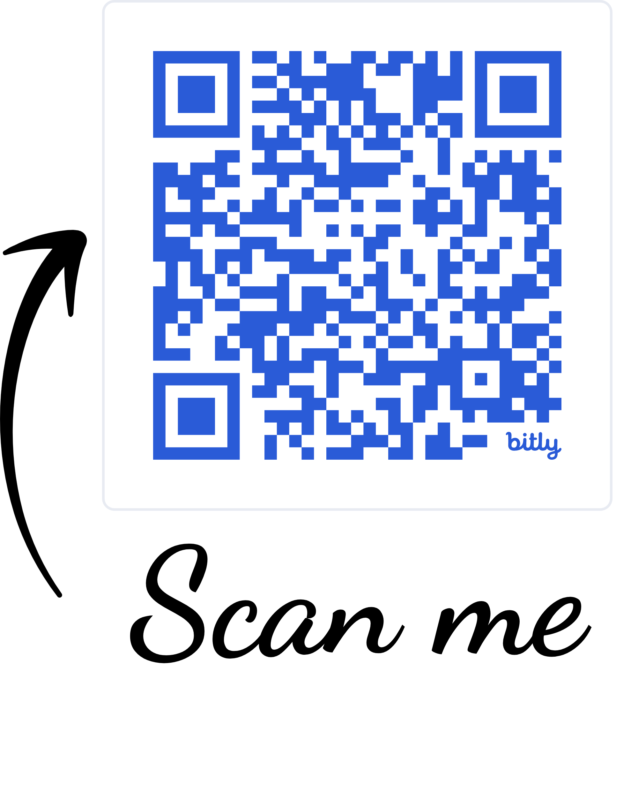

<a href="https://sayjeyhi.com" class="absolute bottom-3 right-24.5 z-50 text-blue-400 text-xs font-bold decoration-none">https://sayjeyhi.com</a>

<!--
Software engineer at HEMA

sayjeyhi.com

scroll and have fun there...

I built it before AI getting so powerful.
-->

---

  <h1 class="mb-0">Raise your hand if you have done this before?</h1>
  

<!--
Before we start...
How many of you have done this?
Raise your hand if you have ever done this

It is really annoying..

I did, and this happened
-->

---
layout: center
class: 'text-center'
---

  <video class="max-h-[92%] max-w-[94%] rounded-xl" autoplay loop muted playsinline src="./public/IMG_1868.MP4" />

<!--
I am not that much Clumsy!
-->

---
layout: center
class: 'text-center'
---

# It is soooo over

  AGI? is this AGI?

<!--
We are kooked!

We are done!

It is soooo over

Then how it will look like?
what should I do?

I was thinking about these ideas about 1 year ago...
-->

---

  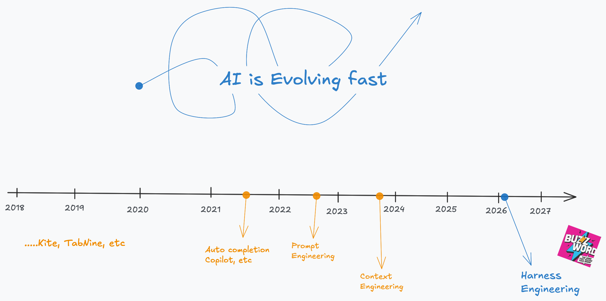

<!--

I still think this is the case,
We are moving so fast and many people are confused!

- Select Model
- Harness engineering 
- Context management
- Guardrail
- etc...
-->

---
layout: center
class: 'text-center'
---

  Real story, it was late 2025 and I was like:

  What was my main pain point when using AI?

Both Personal and Enterprise

---
layout: center
class: 'text-center'
---

# So I built DevM8

  (to be my mate!)

  Dev + M8 — the mate that does the boring work 

---
layout: center
class: 'text-center'
---

# What is DevM8? 

 

A <strong>Rust-based CLI tool</strong> that takes over my daily boring work:

 

-  **Telling AI what to do** — remotely
-  Using the **right skill** for the AI, when it is needed
-  Making **Slack communication** easier
-  **Git branch management** integrated with **Jira**

 

> At that point, there were no accessible Claude agents  
> Today it's easier — doable via almost all agents, natively.

<!--
I am too lazy.
Many of you are!

Jira UI!
Keep branch names and git messages accurate!
Slack and Teams message...

Annnd the laptop closing issue
-->

---

  

    <h1 class="m-0 text-[30px]!">DevM8 in practice</h1>
    
  

  

    server · terminal · Telegram
  

  

    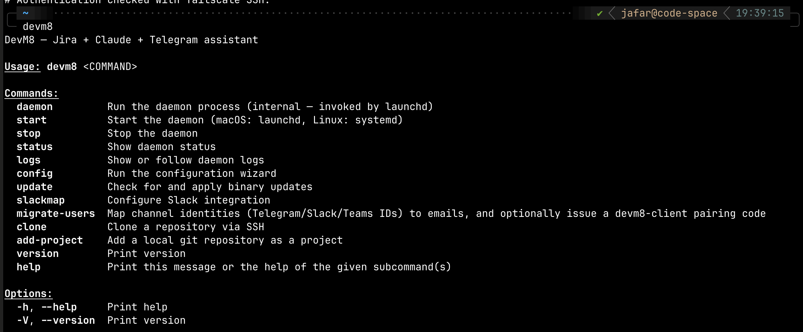
    
SERVER CLI

  

  

    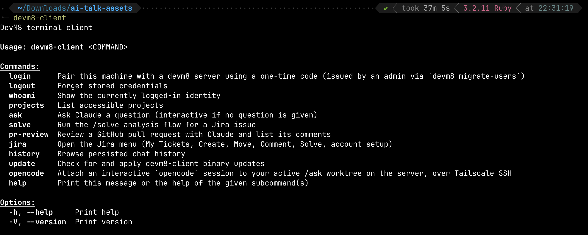
    
devm8-client cli · TUI

  

  

    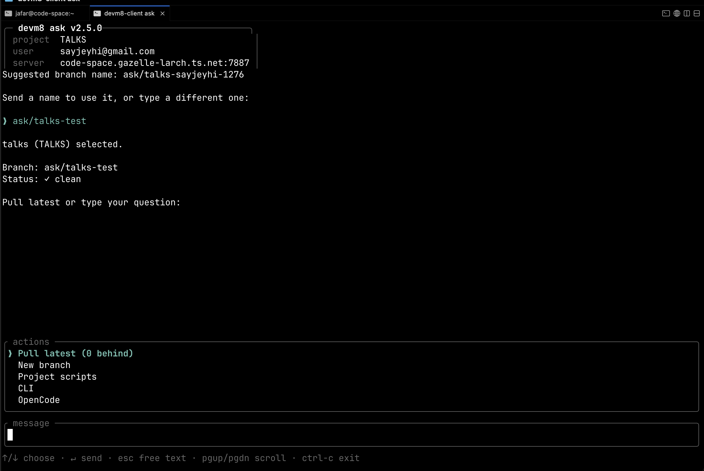
    
devm8-client cli · TUI

  

  

    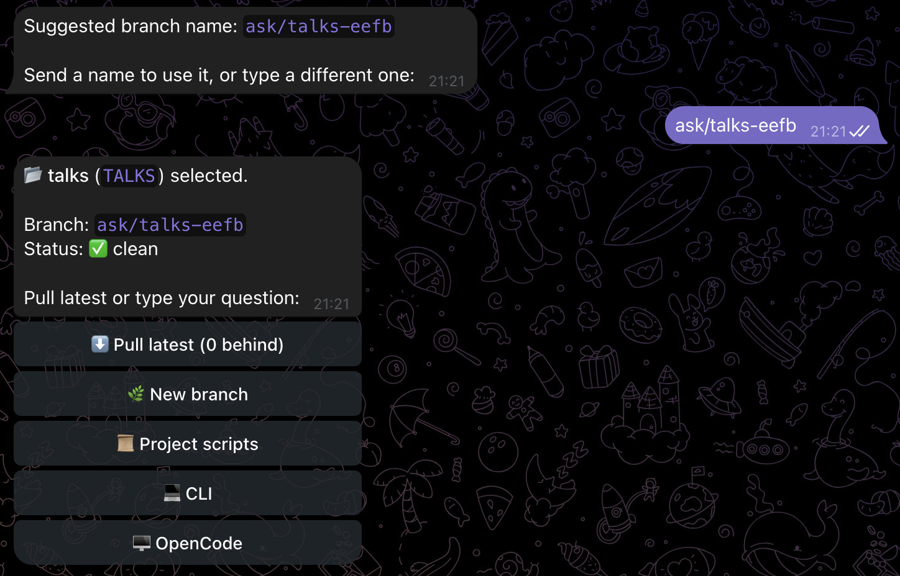
    
Telegram bot · @Devm8_bot

  

  

    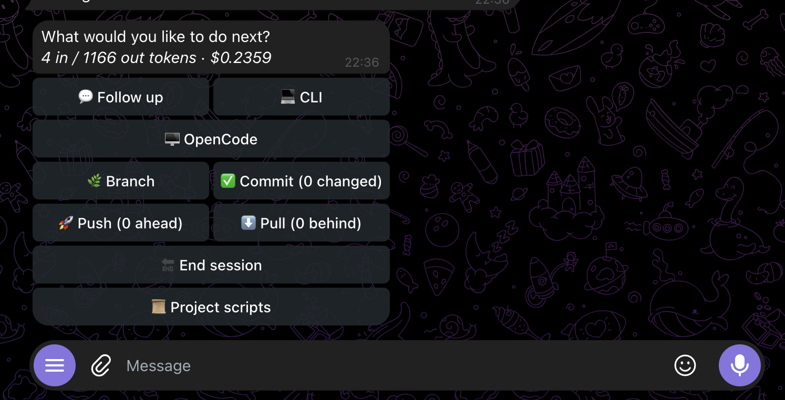
    
Telegram bot · @Devm8_bot

  

  

    One agent, every channel, shared history
  

<!--
This is the visual tour in one frame: the server CLI, the paired client TUI, and the same agent flow in Telegram.

The server stays alive when the laptop closes. Different systems can pair securely through devm8-client. The TUI supports remote work, pull-request review, and Jira. Telegram can start from a suggested branch, select a project, run project actions, and return the final result with the available next actions.
-->

---
layout: center
class: 'text-center'
---

# Demo time!

 

  The real thing — live. No screenshots. 

  A ticket from cli opencode → agent on it → branch ready — while we talk.

<!--

This is not all the solution right? 
we have many AI providers solving many of these..
-->

---

# Where does it live? A homelab 

 

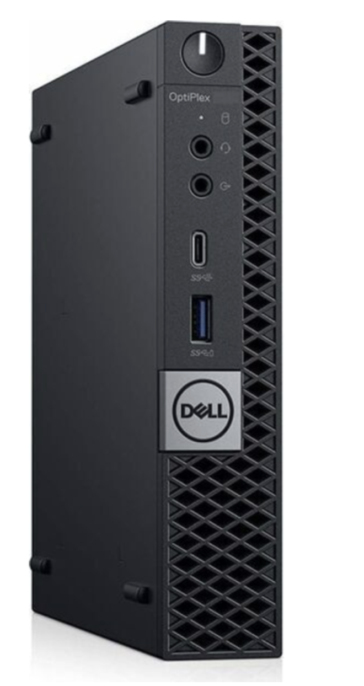

-  **Dell Optiplex 3070 Micro** — a quiet little box, doing real work
-  **AI Agent** — Connected to cloud AI providers
-  **Tailscale** — every device in a private network, ACLs included
-  **OpenCode** — Allows use of opencode within Tailnet VPN 
-  **T3 Server** — An ADE server

 

> My AI agents are available **24/7, remotely** — from my phone, a laptop, anywhere. 

<!--
How many of you have homelab?

Mac mini, Old laptop, PC?

We love hardware,
It is real engineering.
Or atleast feels like that.
-->

---

# How it's all wired 

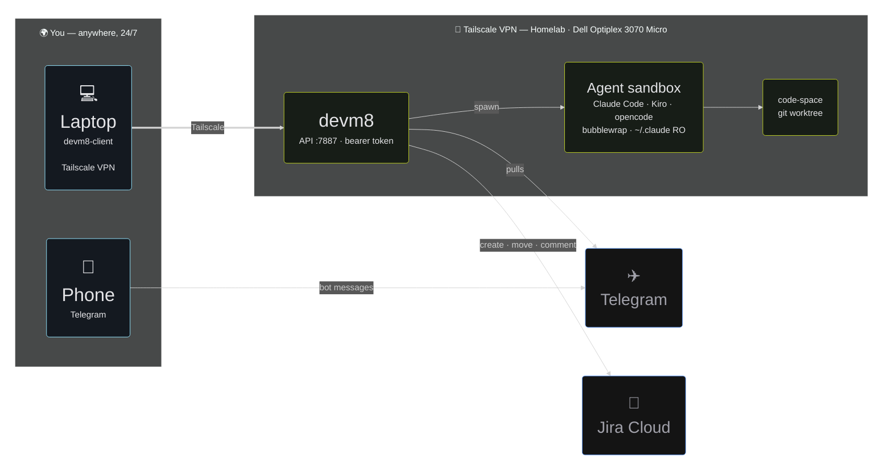

  The only public hops are the bot APIs — everything else rides the tailnet.

<!--
You can read about different setups and you may already have done!

this is more like my setup to demo
-->

---

# I gave it to friends, it got serious 

 

-  **Secure** — every agent run is sandboxed: bubblewrap namespaces, read-only `~/.claude`, `~/.kiro` cleared environment
-  **Multi-tenant** — per-project access control, admin roles, 10-minute pairing codes
-  **Integrated** — Slack and Telegram, plus `devm8-client` for the terminal
-  **Agent-powered** — supporting Claude and Kiro, Base support of Codex

 

> Same assistant, every channel, one shared history. 

 

> It is open source now!

<!--
I was for me only!
but showed friends and they asked..
-->

---
class: 'text-center'
---

  

<h1 class="mt-20">Am I dumb moment?</h1>

Super cool!

This is fantastic!

Does the job!

Wait... what?

This is dumb!

<!--
After a little bit of working with devm8 
First I said yeah this is fantastic.
Then it was just working

Then I said this is Dumb!

Let me explain why...
-->

---
layout: center
class: 'text-center'
---

  

    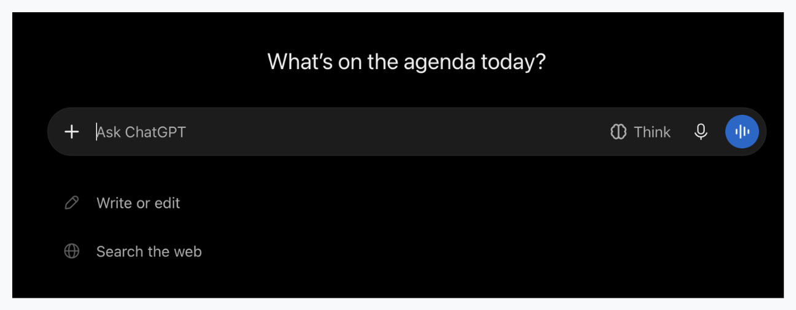
  

  http://chatgpt.com

  

    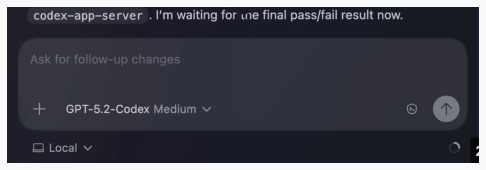
  

  Codex

  Same chat interfaces, isn't it?

<!--
What happens under the hood?
-->

---

  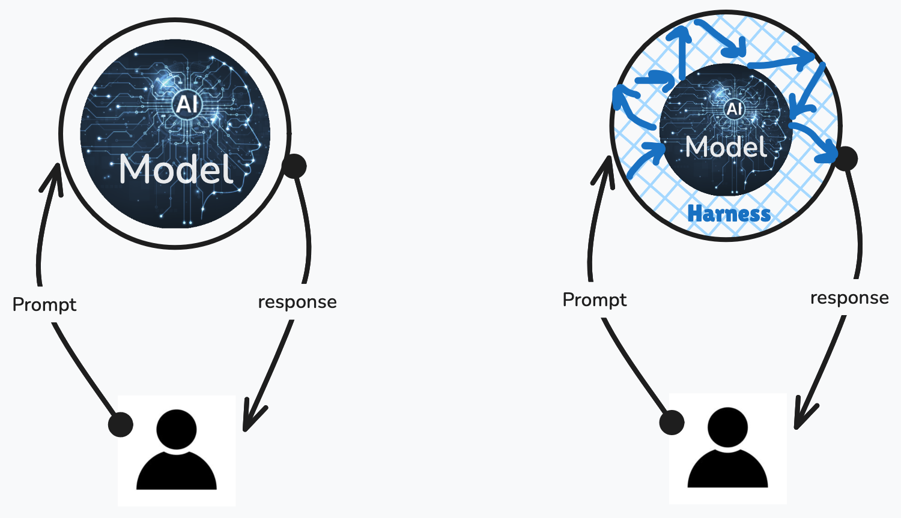

<!--
AI Model is not Harness 
--> 

---

  

<h1 >An LLM only produces text</h1>

Prompt

text in

LLM

Response

text out

no files changed

no commands run

<!--
Strip away the product framing and an LLM has one primitive: it consumes text and emits text. A response alone does not read a repository, edit a file, or run a command.
-->

---
layout: center
class: 'text-center'
---

# The model supplies decisions. 
# The harness supplies consequences.

---

  

<h1>The empty kitchen</h1>

Smart chef

knows the recipe

Empty

no knife no pan no stove

No dinner

Capability without tools cannot become action.

<!--
Use the kitchen analogy from the transcript. A brilliant chef in an empty room can describe dinner but cannot cook it. Capability needs tools and an environment where actions have consequences.
-->

---
layout: center
class: 'text-center'
---

# Demo time!

 

  Let's build a simple kitchen!

<!--
This is a basic run time harness which does 

manages all AI model can do in your code
-->

---
layout: center
class: 'text-center'
---

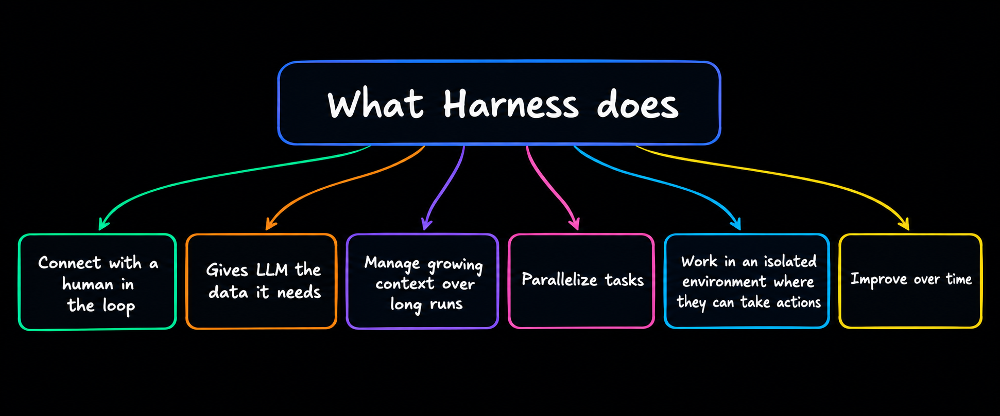
 
<!--
What does happen there?

Human loop
Context management

To take best of harness 
-->

---
layout: center
class: 'text-center'
---

  Same prompt to different harnesses 
  uses a different amount of tokens

  [system prompt]

<!--

You can try 
But based on what I tried the different harnesses

spend different amount of tokens for the same prompt in same project
-->

---

  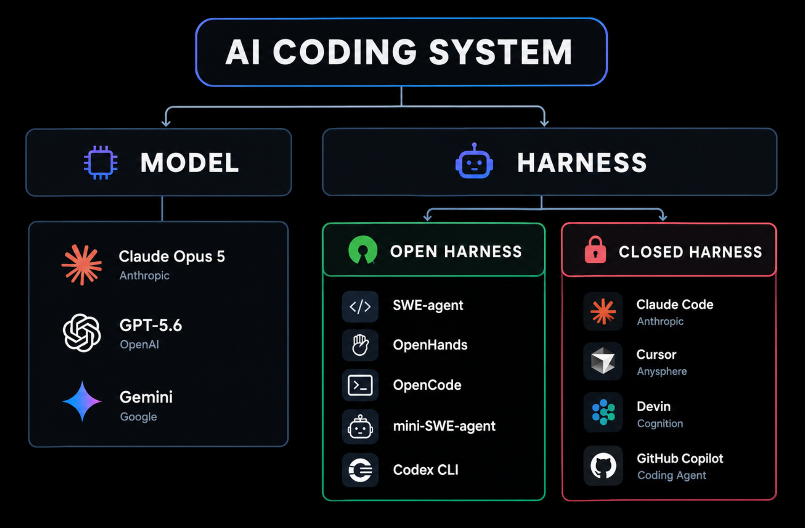

<!--
Good thing is we have many options...

Open and closed sources
-->

---
layout: center
class: 'text-center'
---

# Open weight vs Close weight models

---

<h1 class="mb-10">Open weights ≠ open source</h1>

  

    
Open weights

    
download · run · fine-tune

    <ul class="list-none p-0 m-0">
      <li class="flex items-start gap-3 py-2 text-base text-zinc-200">✓ Trained parameters (weights, biases)</li>
      <li class="flex items-start gap-3 py-2 text-base text-zinc-200 border-t border-white/6">✕ Training code</li>
      <li class="flex items-start gap-3 py-2 text-base text-zinc-200 border-t border-white/6">✕ Full training data</li>
      <li class="flex items-start gap-3 py-2 text-base text-zinc-200 border-t border-white/6">✕ Reproducible build recipe</li>
    </ul>
    
Llama · DeepSeek · Qwen

  

  

    
Open source AI

    
reproduce · audit (OSI standard)

    <ul class="list-none p-0 m-0">
      <li class="flex items-start gap-3 py-2 text-base text-zinc-200">✓ Trained parameters (weights, biases)</li>
      <li class="flex items-start gap-3 py-2 text-base text-zinc-200 border-t border-white/6">✓ Training code</li>
      <li class="flex items-start gap-3 py-2 text-base text-zinc-200 border-t border-white/6">✓ Data transparency</li>
      <li class="flex items-start gap-3 py-2 text-base text-zinc-200 border-t border-white/6">✓ Rebuild an equivalent model from scratch</li>
    </ul>
    
OLMo (much rarer)

  

Open weights give you the model. Open source gives you the model plus the recipe to rebuild it.

<!--
An open-weight model is not the same as an open-source model.

Open weights: you get the trained parameters so you can download, run, and fine-tune the model. You do not get the training code, the full training data, or the recipe used to build it. Examples: Llama, DeepSeek, Qwen.

Open source AI: under standards like the Open Source Initiative (OSI), true open source gives you the weights plus the training code, meaningful data transparency, and the ability to reproduce or audit a substantially equivalent model from scratch. Examples meeting the full bar are much rarer, such as OLMo.
-->

---

  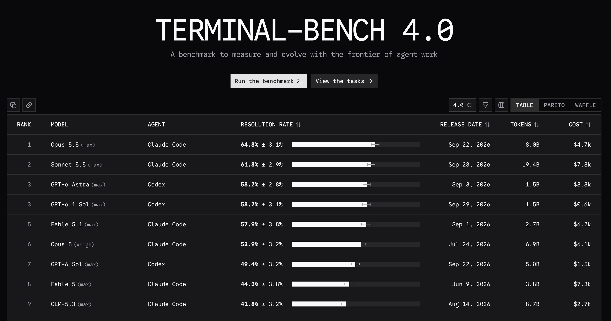

---

<h1>Terminal bench-4.1 pareto</h1>
  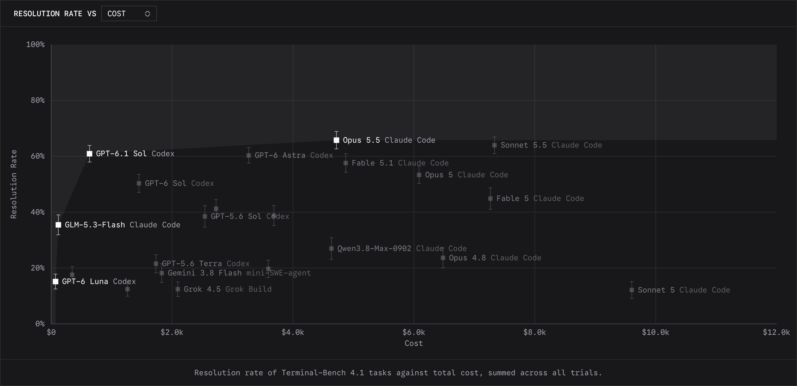

---

<h1>SWE bench Table</h1>
  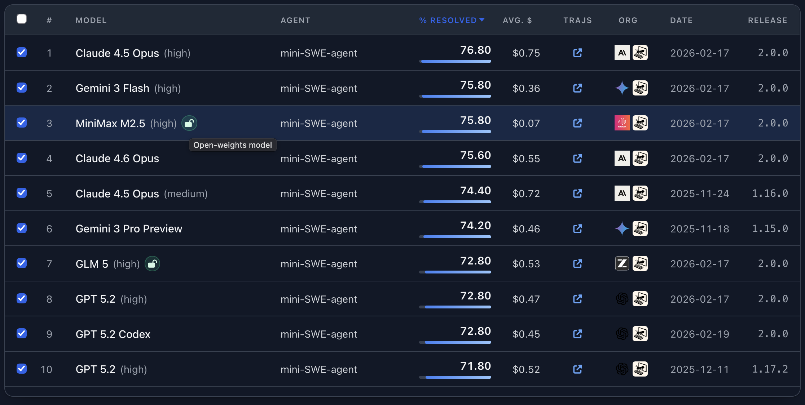

---

<h1>SWE bench Chart</h1>
  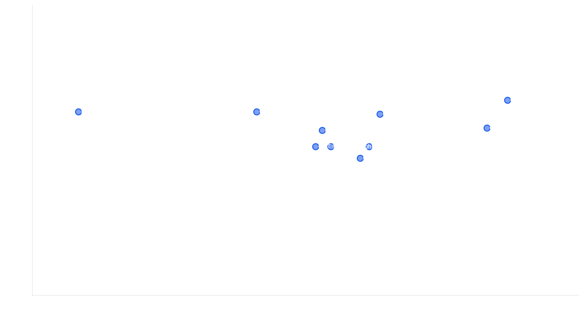

---

  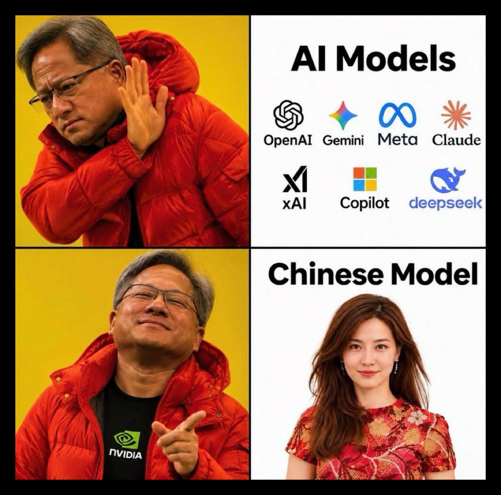

---

  <h1 class="m-0">The harness changes the result</h1>
  
SAME MODEL ≠ SAME SYSTEM

  
Coding tasks

  

SWE-bench

resolve real GitHub issues

  

Terminal-Bench

terminal engineering tasks

  

DeepSWE

agentic software fixes

  
Tool use & agents

  

T-bench

tools in live conversation

  

HAL

cost-aware, cross-scaffold

  

GAIA

general assistant tasks

  
Harness comparison

  

Harness Leaderboard

which harness per model

  

AA Coding Agents

cost, tokens, run time

  

Bench Harness

CC, Codex, OpenCode runs

Same model, different harness: score swings rival the gap between frontier models.

<!--
These are real benchmarking and leaderboard tools for agents and their harnesses. They measure different things, so compare each tool's harness effect, not raw scores across tools.

Coding tasks:
- SWE-bench: resolve real GitHub issues; has several variants (Verified, Pro, Multilingual, Live). https://www.swebench.com
- Terminal-Bench: terminal-based engineering tasks, end to end. https://www.vals.ai/benchmarks/terminal-bench-4
- DeepSWE: agentic software-fix benchmark used in harness comparisons.

Tool use and agents:
- tau-bench / tau2-bench (Sierra): dynamic user conversations with domain API tools and policies. https://github.com/sierra-research/tau-bench
- HAL, Holistic Agent Leaderboard (Princeton): standardized, cost-aware, third-party evaluation across models, scaffolds, and benchmarks. https://hal.cs.princeton.edu
- GAIA: general assistant tasks requiring tool use and reasoning.

Harness comparison:
- Harness Leaderboard (Joel Niklaus, HuggingFace): answers "for model X, which coding-agent harness should I run?" https://huggingface.co/spaces/joelniklaus/harness-leaderboard
- Artificial Analysis Coding Agents: real-world cost, token usage, and execution time across agents, models, and settings. https://artificialanalysis.ai/agents/coding-agents
- Bench Harness: public leaderboard for Claude Code, Codex, OpenCode, and others across coding, terminal, browser, and tool-use benchmarks. https://benchharness.dev

Key point: same model under a different scaffold can swing scores by roughly 17 to 22 points, larger than the gap between most frontier models.
-->

---
layout: center
---

  
There is a Fact!

  

---
layout: center
class: 'text-center'
---

  Rank 30 → top 5

  on <a href="https://www.tbench.ai/">Terminal-Bench 2.0</a> for DeepAgents

  with <strong class="text-[#95E6FF]">harness-only changes</strong>, same model

<a class="text-[11px]" hreaf="https://www.vtrivedy.com/posts/improving-deep-agents-with-harness-engineering">Source: Trivedi, “Improving Deep Agents with Harness Engineering” (LangChain, 2026)</a>

<!--
But still!

building a good harness arround the models make a real sense

Based on Terminal Bench results in 2026

Usually native runtime harnesses are the best
-->

---
layout: center
class: 'text-center'
---

  The LLM is ~10% of an agentic system

  the harness is the other <strong class="text-[#95E6FF]">90%</strong>

 

  Google's <em>The New SDLC With Vibe Coding</em> — conceptual framing

<!--
Google's 2026 paper

Harness and Agentic systems arround it
-->

---
layout: center
class: 'text-center'
---

  What model does it use? Or do you use?

 

  is increasingly the <a href="https://magnus919.com/2026/06/stop-picking-models.-start-building-harnesses./" class="bold text-[#CF8377]">wrong question</a>

---

  

<h1 class="pr-25">What deserves your attention?</h1>

Product

Engineers

Architecture

Languages

Frameworks

Algorithms

Tabs vs spaces

more outcome

<!--
Developers care about many layers. Tabs and spaces sit near the bottom. Product outcomes sit at the top. Our attention should follow the impact, not our attachment to a tool.
-->

---
layout: center
class: 'text-center'
---

# Harnesses matter.
# Then they will disappear.

  The harness still changes result quality. 
  But harnesses are catching up fast to each other.

The harness matters today. As they converge, which one you pick matters less.

<!--
We said LLM is 10%
And Harness changes the results quality

Yes,
But I believe and you might also noticed,
they are catching up pretty quick!
-->

---

  

<h1 >Abstraction moves the line</h1>

the work moves up a layer

Vim/Neo Vim

party tricks

Editors

Multi-Terminals

tmux, cmux, ...

Harnesses

simple harness

Agents

gurded agentic envs

<!--
We are living in a live world.

Abstraction is not waiting for us to capture!

We must adopt!
And we need to stay curios and question the basics.
-->

---
layout: center
---

  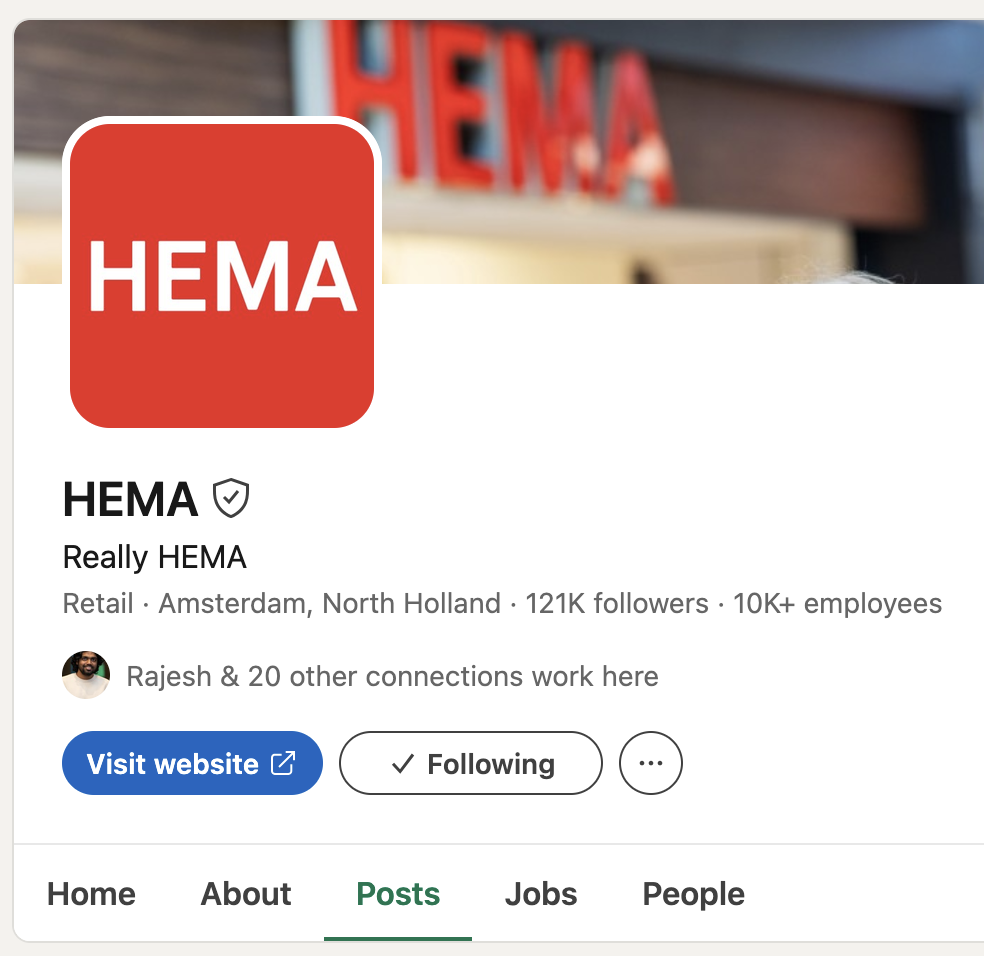

  
  

    The future is agentic  
    so at HEMA we're building a full harness, just like Claude
  

  Our own complete agent runtime 

<!--
A big retail company in west NL, BE, DE, FR.

We have more than 10K employees
-->

---
layout: center
class: 'text-center'
---

  Lied!

  No custom runtime, we using different <strong>AI Agents</strong> 
  What we <strong class="text-[#BECF24]">Do</strong> did is <strong class="text-[#BECF24]">A Harness Engineering</strong> around an agentic CLI

  

---

# Two kinds of harness 

 Harness

    What makes an LLM a <strong class="text-[#95E6FF]">coding agent</strong>.

    Shell · tools · context · skills · sub-agents · permissions · hooks · MCP · compaction

    Shipped by Claude Code, Codex, opencode…

 Engineering harness

    What makes agents <strong class="text-[#BECF24]">reliable and scalable</strong> across a team.

    Specs · orchestration · workers · validators · evals · guardrails · CI · observability

    The part <em>you</em> build, where your edge lives 

 

> Agent = model + runtime harness. <strong>Production agent</strong> wraps that in an engineering harness.

    The runtime gives the building blocks. The engineering harness uses them at team scale.

<!--
The Harnesses are Open for us to help them work better.

So we need to do some lets say engineering arround the harness to use it at its most capability
-->

---
class: slide-bg-121212
---

  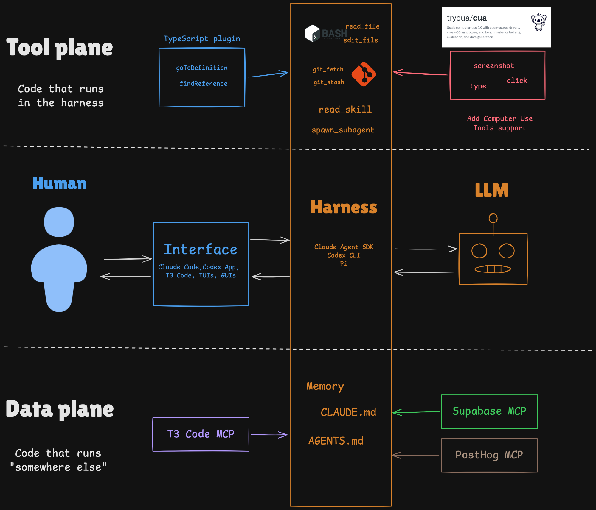

<!--
Take the most from LLM and harness
-->

---

  

<h1 >Agent is LLM + harness</h1>
 

LLM

reason + text

+

Harness

tools + loop

=

Agent

completes tasks

<!--
This is the compact definition: a model combined with a harness becomes an agent. The model supplies reasoning and text. The harness supplies tools, context, a system prompt, and the execution loop.
-->

---
layout: center
class: 'text-center'
---

# so, How do you use AI today?

  The answer here is valuable

<!--
I think this is a really valid question 
and people working in big tech should share more and you need to also listen to them..
-->

---

# Meet opa-cli 

  One CLI that controls everything — the whole pipeline, end to end:

  📝 Spec creation
  →
  🎫 Jira ticket
  →
  📄 Create PRD
  →
  🛠️ Implement
  →
  📏 Guidelines

↓

  🔑 AWS profiles
  →
  ⚙️ AWS Pipelines
  →
  🚀 Deploy
  →
  🧪 Test

  Every step of the organization agent driven by one command.

<!--
This is not another Ticket to PR skill

and It doesn't mean we can one-shot tickets
But we do have a pretty high quality results...

It is more like a state machine, telling harness what can it do in each state...
-->

---
class: slide-bg-121212
---

  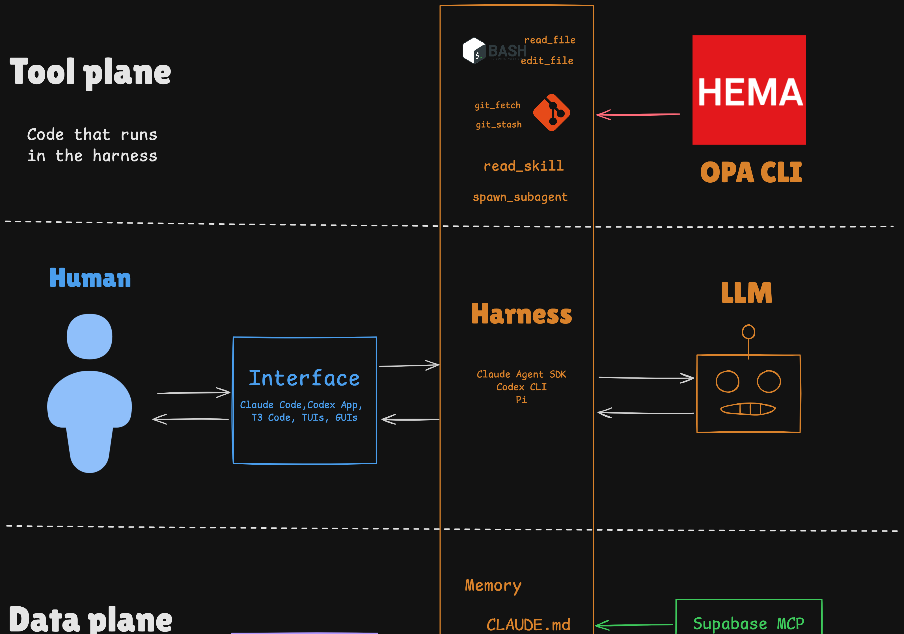

---
layout: center
class: 'text-center'
---

# Is that where we stop?

<!--
My problems are not yet solved with this.

I don't want to pay lots of money to just rent a computer on cloud.

Still need to open different editors, terminals. manage subs, git, PR etc.
-->

---

  

<h1 class="pr-40">From IDE to ADE</h1>

Agentic development environment

Interfaces

Harnesses

Models + tools

attention moves up

<!--
The transcript names T3 Code an Agentic Development Environment, or ADE. It sits above interfaces and harnesses as the place where humans manage agentic work. Like IDEs, ADEs may become less visible as the next abstraction arrives.
-->

---

  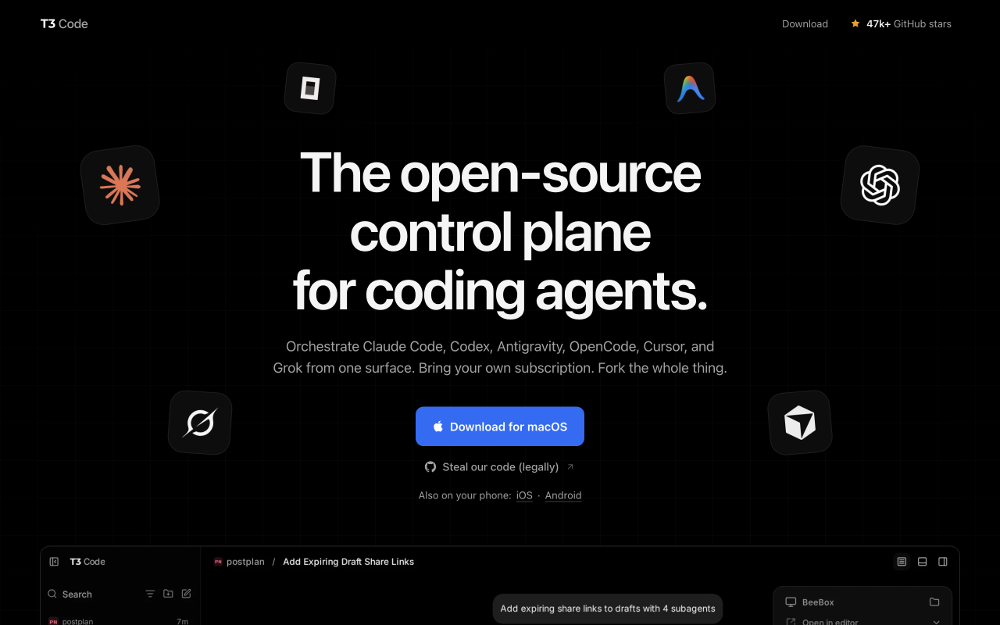

<!--
This was the closest solution for my problems!
-->

---
layout: center
class: 'text-center'
---

  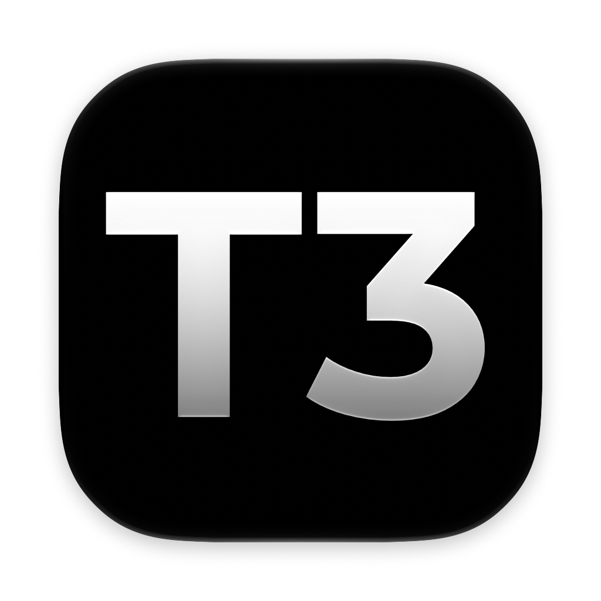
  

    <h1 class="text-6xl!">T3 Code</h1>
    
One place to run, watch, and coordinate coding agents.

    
Open source. Your machines. Your provider subscriptions.

  

---

  

<h1>T3 Code coordinates harnesses</h1>

<svg width="56" height="56" viewBox="0 0 24 24" fill="none" stroke="#95E6FF" stroke-width="1.5" stroke-linecap="round" stroke-linejoin="round"><circle cx="12" cy="7" r="4"/><path d="M4 21c0-4.4 3.6-8 8-8s8 3.6 8 8"/></svg>

Human

T3 Code

ADE + MCP coordination

Claude Code

Codex

Other harness

one interface, native harness behavior

<!--
T3 Code does not replace every harness. Its interface and MCP layer coordinate them. Claude Code keeps its own skills and plugins. Codex keeps its own behavior. T3 Code brokers work and history across them.
-->

---

  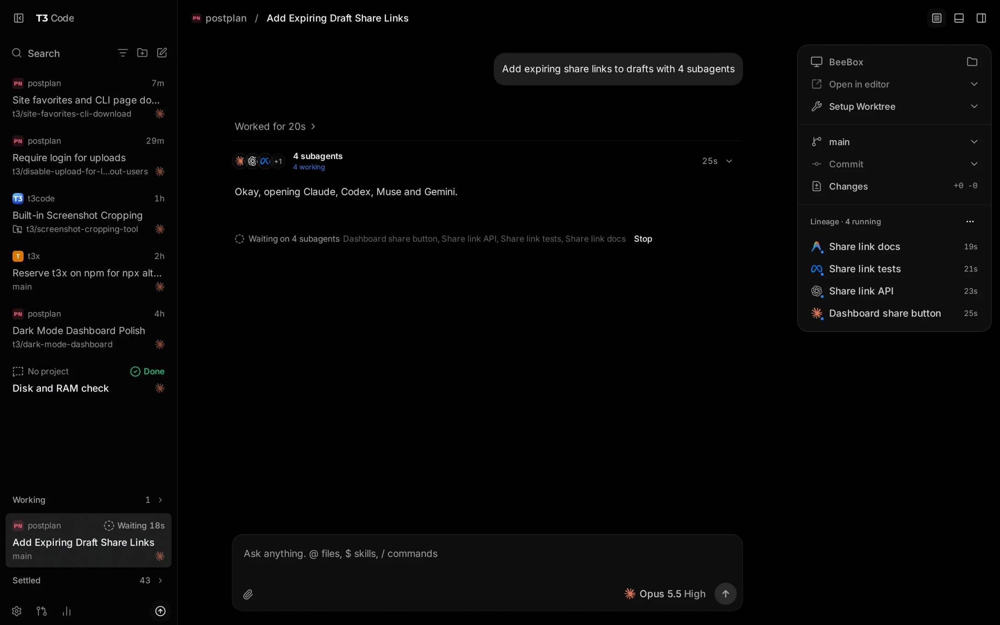

Official product screenshot from <a href="https://t3.codes">t3.codes</a>

<!--
Orient the audience. The left side is the thread inbox, the center is the active conversation, and the right side holds the project, Git, and sub-agent context.
-->

---

# One thread can become a team

  

  One parent thread
  Claude + Codex + Muse + Gemini sub-agents
  One lineage panel

<!--
The official screenshot shows four sub-agents in one thread. 01.md also describes threads communicating with one another. The user starts with one task and delegates work to different models where useful.
-->

---

<h1 class="pb-8">Threads connect through MCP</h1>

---

# The sidebar is an inbox for work

  

    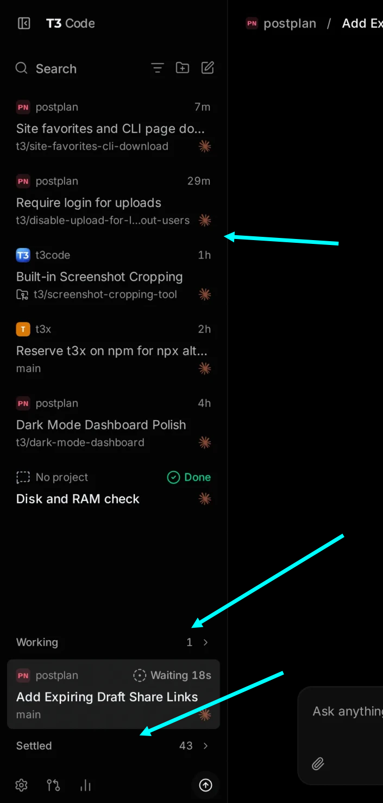
  

  

    

      
Draft

      
Start before it runs.

    

    

      
Working

      
Hide active work.

    

    

      
Snoozed

      
Return later.

    

    

      
Settled

      
Close completed work.

    

    

      
Archived

      
Out of sight.

    

  

<!--
No struggle finding history between different harnesses! 
And switching them.

Change the harness t3code will handle the rest
-->

---

  

<h1>From thread to merged pull request</h1>

thread

commit

push

PR

review

merge

linked reviews stay with the work that created them

readiness, stacks, diffs, merge, done

<!--
A thread can commit, push, create a pull request, review changes, and merge. Linked pull requests remain attached to the work that produced them, including stacked reviews.
Source: https://github.com/pingdotgg/t3code/blob/main/docs/user/source-control.md
-->

---
layout: center
class: 'text-center'
---

# Demo time!

 

  See T3 Code in action...

---

<h1 class="pb-2">Three machines, one client</h1>

---

# 

<h1 class="pb-8">At home, the LAN is enough</h1>

<!--
In a home Local Access Network is it simple.
-->

---

<h1 class="pb-8">T3 Connect</h1>

---

<h1>T3 Connect vs Tailscale</h1>

<!--
This opens up some new doors,

features like load balancing the work

using other computer resources... etc!
-->

---

  

<h1>Send work where capacity exists</h1>

New thread

Choose host

MacBook

1 slot free

Mac Studio

8 slots free

Linux VM

3 slots free

pick once, then keep the thread on that machine

<!--
When a draft needs a machine, T3 Code can examine eligible hosts and choose one with free capacity. After selection, the thread stays on that environment.
Source: https://github.com/pingdotgg/t3code/blob/main/docs/user/remote-access.md#balance-new-threads-across-machines
-->

---
layout: center
class: 'text-center'
---

# Source control is built into the work

  
GitHub

  
GitLab

  
Bitbucket

  
Azure DevOps

  
Forgejo

  
Gitea

  
GitCafe

  
Your Git host

Review diffs, link pull requests, inspect stacks, and merge without leaving the thread.

Source: <a href="https://github.com/pingdotgg/t3code/blob/main/docs/user/source-control.md">official source-control docs</a>

<!--
The current documentation lists GitHub, GitLab, Forgejo, Gitea, Bitbucket, Azure DevOps, and GitCafe. This is wider than the PR-only framing in 01.md.
-->

---

  

<h1>Work can start without a human click</h1>

Schedule

cron or interval

Webhook

event payload

Automation policy

New agent thread

signed requests, dedupe keys, held delivery

<!--
Schedules and webhooks can start threads. Current webhook settings support signed requests, payload placeholders, deduplication keys, and delivery held by T3 Connect for up to 24 hours while an environment is unavailable.
Source: https://github.com/pingdotgg/t3code/blob/main/docs/user/project-settings.md#webhook-automations
-->

---

# See where the tokens go

  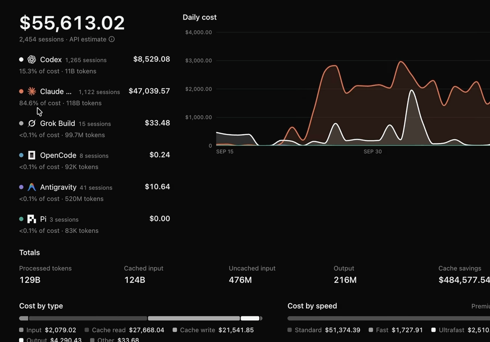

  

    
BY ACCOUNT

    
Who?

    
Compare usage across connected provider accounts.

  

  

    
BY MACHINE

    
Where?

    
See which environment is consuming the work.

  

---

# Free transcripts, any language 

  Run <strong class="text-[#BECF24]">local or remote models</strong> to transcribe speech

  
     Local on your machine
  
  
     Many languages
  
  
     For free
  

  Whisper and friends turn any voice into text, auto-detect the language, even translate 

  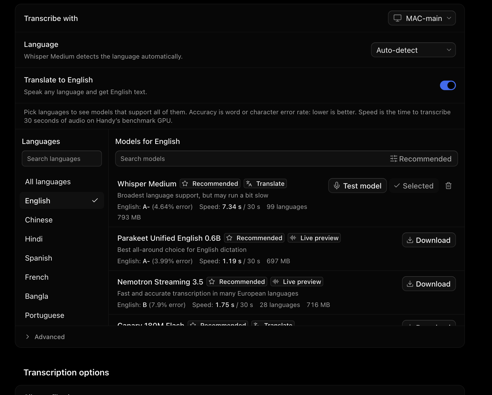

<!--
You do not need a paid API for transcription.

Pick a local or remote open model like Whisper, point it at your audio, and it writes the transcript for free. It auto-detects the language across dozens of them, and can even translate speech to English on the way.
-->

---

# Control a simulator from your phone!

  

    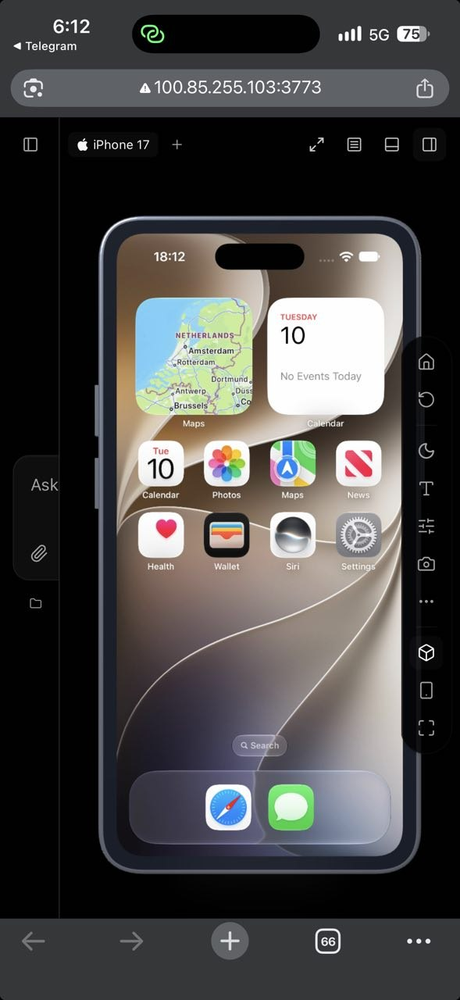
  

  

    
Run agents from your phone

    

      

        Tailscale network
         — my devices on one private mesh.
      

      

        Mobile browser
         — no app to install, just a URL.
      

      

        Remote control
         — drives a device on my Mac from anywhere.
      

    

  

<!--
This is fun!

It is chrome opened in my iphone, 
controlling an emulator device on my mac!
-->

---
layout: center
class: 'text-center'
---

# Android and iOS apps

  

    
    
Sessions

  

  

    
    
Environments

  

  

    
    
Chat

  

  

    
    
Terminal

  

<!--
The mobile client is not a smaller editor. It is a remote operations interface for agent work and connected machines.
-->

---

<h1 class="pb-8">Fleet - one HQ synced on every machine</h1>

<!--
There is still one issue not solved by t3 and I solved it for my self. 

I have HQ.
-->

---

  
  

    
OPEN SOURCE CONTROL PLANE

    <h1 class="text-5xl! mt-3">Try it. Inspect it. Fork it.</h1>
  

  

47,521

GitHub stars

  

MIT

license

  

BYO

models + compute

  <a href="https://t3.codes" class="text-[#95E6FF]">t3.codes</a>
  ·
  <a href="https://github.com/pingdotgg/t3code" class="text-[#BECF24]">github.com/pingdotgg/t3code</a>

Repository figures retrieved 5 Nov 2026 from the GitHub API. Content adapted from 01.md and current official docs.

<!--
I would highly recommend to try t3code

Go play with that and see if that works for you.
-->

---

  

---

# Resources 

## Used in this deck

- **Harness transcript:** [My last video about AI harnesses](https://www.youtube.com/watch?v=ebILGCoN4UU)
- **T3 Code summary:** [T3 Code broke me](https://youtu.be/uLGxb4F3SyI)
- **T3 Code:** [t3.codes](https://t3.codes)
- **Source and releases:** [pingdotgg/t3code](https://github.com/pingdotgg/t3code)
- **Remote access:** [official docs](https://github.com/pingdotgg/t3code/blob/main/docs/user/remote-access.md)
- **Source control:** [official docs](https://github.com/pingdotgg/t3code/blob/main/docs/user/source-control.md)
- **Automations:** [project settings](https://github.com/pingdotgg/t3code/blob/main/docs/user/project-settings.md)
- **Troubleshooting:** [triage docs](https://github.com/pingdotgg/t3code/blob/main/docs/user/triage.md)

## Harness engineering

- **HEMA HAL:** [AWS case study](https://aws.amazon.com/blogs/machine-learning/from-portal-hopping-to-instant-answers-hemas-journey-with-mcp-and-amazon-bedrock/)
- **OpenAI DevDay 2026:** [recap](https://openai.com/index/devday-2026-recap)
- **Anthropic coding trends:** [2026 report](https://resources.anthropic.com/2026-agentic-coding-trends-report)
- **AI coding agents:** [JetBrains research](https://blog.jetbrains.com/research/2026/08/ai-coding-agent-adoption-2026)
- **autoharness:** [self-learning harness](https://github.com/tigerless-labs/autoharness)
- **myagents:** [portable harness](https://github.com/RashadAnsari/myagents)
- **Collection:** [Awesome harness engineering](https://github.com/ai-boost/awesome-harness-engineering)

## Foundations

- **AI transformation:** [Just Another Transformation](https://dpereira.substack.com/p/just-another-transformation)
- **Harness engineering:** [Martin Fowler](https://martinfowler.com)
- **DeepSeek Harness:** [source](https://github.com/deepseek-ai/deepseek-harness)
- **DeepSeek overview:** [MindStudio](https://mindstudio.ai/blog/deepseek-harness-agentic-coding)
- **Harness deep dive:** [video](https://youtu.be/UsfCe5fJK6A)
- **Skylos:** [catch mistakes before push](https://github.com/duriantaco/skylos)

---
layout: center
class: 'text-center'
---

# Thank you! 

 

  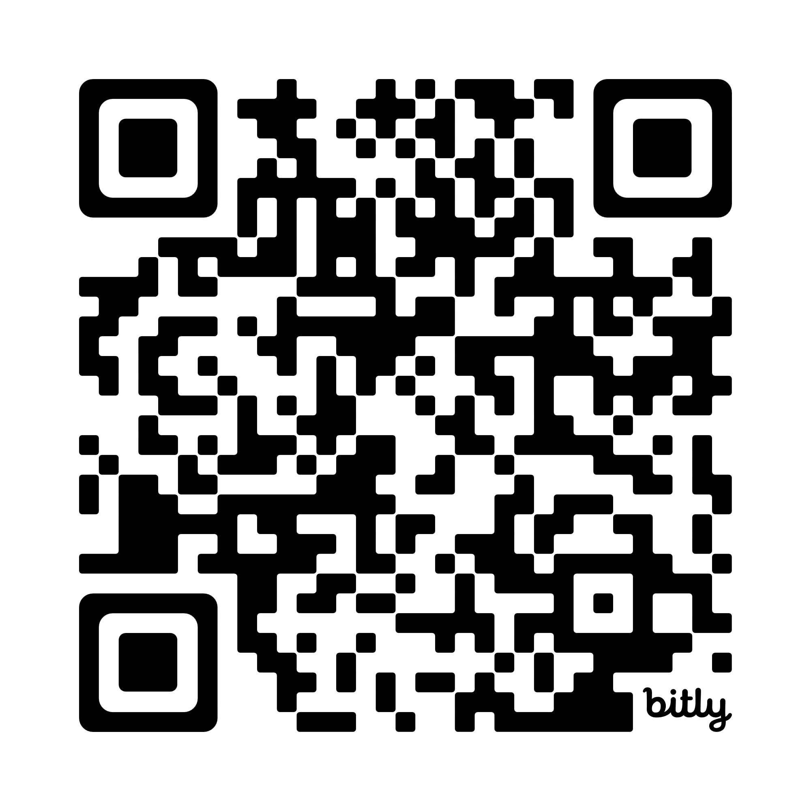

  

    <strong class="text-xl">Reach out to me!</strong>  
    

      <a href="github.com/sayjeyhi" >
       Jafar Rezaei
      </a>
      <a href="https://sayjeyhi.com">
       sayjeyhi.com
      </a>
      

    @sayjeyhi
  

