# Oh My Harness

Ultimate usage of harnesses

  
    <carbon:arrow-right class="inline"/>
  

  

  <a class="text-left ml-4 mt-2 decoration-none" href="https://github.com/sayjeyhi">
    <strong class="text-xl">Jafar Rezaei</strong>  
    
November 2026

    
GoTechWorld Bucharest

  </a>

<!--
Hope not boread and tired...

Should we play an ice breaker game?
-->

---

# WHO AM I?
> Jafar Rezaei **@sayjeyhi**  -    Fullstack Software Engineer @HEMA

<iframe class="mt-2" style="transform: scale(0.5, 0.5) translate(-50%, -50%); position: absolute; left: 10%; right: 50%; " src="https://sayjeyhi.com?v=2" width="160%" height="140%" />

<!--
Software engineer at HEMA

sayjeyhi.com

scroll and have fun there...

I built it before AI getting so powerful.
-->

---

  

<!--

I still think this is the case,
We are moving so fast and many people are confused!

- Select Model
- Harness engineering 
- Context management
- Guardrail
- etc...
-->

---
layout: center
class: 'text-center'
---

  What was my main pain point when using AI?

Both Personal and Enterprise

---

  

<!--
How many of you have done this?

It is really annoying..

I did, and this happened
-->

---
layout: center
class: 'text-center'
---

  <video class="max-h-[92%] max-w-[94%] rounded-xl" autoplay loop muted playsinline src="./public/IMG_1868.MP4" />

---
layout: center
class: 'text-center'
---

# It is soooo over

  AGI? is this AGI?

<!--
We are kooked!

We are done!

It is soooo over

Then how it will look like?
what should I do?

I was thinking about these ideas about 1 year ago...
-->

---
layout: center
class: 'text-center'
---

# So I built DevM8

  (to be my mate!)

  Dev + M8 — the mate that does the boring work 

---
layout: center
class: 'text-center'
---

# What is DevM8? 

 

A <strong>Rust-based CLI tool</strong> that takes over my daily boring work:

 

-  **Telling AI what to do** — remotely
-  Using the **right skill** for the AI, when it is needed
-  Making **Slack communication** easier
-  **Git branch management** integrated with **Jira**

 

> At that point, there were no accessible Claude agents  
> Today it's easier — doable via almost all agents, natively.

<!--
I am too lazy.
Many of you are!

Jira UI!
Keep branch names and git messages accurate!
Slack and Teams message...

Annnd the laptop closing issue
-->

---

  

    <h1 class="m-0 text-[30px]!">DevM8 in practice</h1>
    
  

  

    server · terminal · Telegram
  

  

    
    
SERVER CLI

  

  

    
    
devm8-client cli · TUI

  

  

    
    
devm8-client cli · TUI

  

  

    
    
Telegram bot · @Devm8_bot

  

  

    
    
Telegram bot · @Devm8_bot

  

  

    One agent, every channel, shared history
  

<!--
This is the visual tour in one frame: the server CLI, the paired client TUI, and the same agent flow in Telegram.

The server stays alive when the laptop closes. Different systems can pair securely through devm8-client. The TUI supports remote work, pull-request review, and Jira. Telegram can start from a suggested branch, select a project, run project actions, and return the final result with the available next actions.
-->

---

# I gave it to friends, it got serious 

 

-  **Secure** — every agent run is sandboxed: bubblewrap namespaces, read-only `~/.claude`, `~/.kiro` cleared environment
-  **Multi-tenant** — per-project access control, admin roles, 10-minute pairing codes
-  **Integrated** — Slack and Telegram, plus `devm8-client` for the terminal
-  **Agent-powered** — supporting Claude and Kiro, Base support of Codex

 

> Same assistant, every channel, one shared history. 

 

> It is open source now!

<!--
I was for me only!
but showed friends and they asked..
-->

---

# Where does it live? A homelab 

 

-  **Dell Optiplex 3070 Micro** — a quiet little box, doing real work
-  **AI Agent** — Connected to cloud AI providers
-  **Tailscale** — every device in a private network, ACLs included
-  **OpenCode** — Allows use of opencode within Tailnet VPN and access token

 

> My AI agents are available **24/7, remotely** — from my phone, a laptop, anywhere. 

<!--
How many of you have homelab?

Mac mini, Old laptop, PC?

We love hardware,
It is real engineering.
Or atleast feels like that.
-->

---

# How it's all wired 

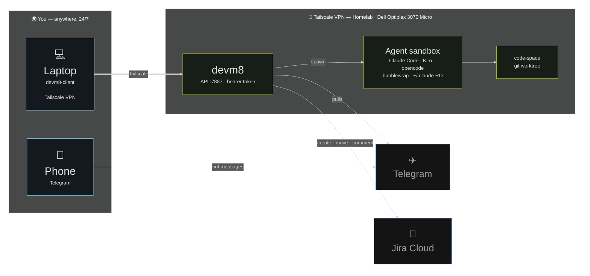

  The only public hops are the bot APIs — everything else rides the tailnet.

<!--
You can read about different setups and you may already have done!

this is more like my setup to demo
-->

---
layout: center
class: 'text-center'
---

# Demo time!

 

  The real thing — live. No screenshots. 

  A ticket from cli opencode → agent on it → branch ready — while we talk.

<!--

This is not all the solution right? 
we have many AI providers solving many of these..
-->

---
layout: center
class: 'text-center'
---

  

    
  

  http://chatgpt.com

  

    
  

  Codex

  Same chat interfaces, isn't it?

<!--
What happens under the hood?
-->

---

  

<!--
AI Model is not Harness 
--> 

---
layout: center
class: 'text-center'
---

 
<!--
What does happen there?

Human loop
Context management

To take best of harness 
-->

---
layout: center
class: 'text-center'
---

  Lets build a harness?

  

  You are not mentally ill to do so! 

<!--
Dario..

But in some cases it can be useful though

General purpose harnesses are powerful
but in some special cases like maybe finance or sensitive data 

-->

---
layout: center
class: 'text-center'
---

# Demo time!

 

  A basic AI harness to have custom implementation...

<!--
This is a basic run time harness which does 

manages all AI model can do in your code
-->

---

  

<!--
Good thing is we have many options...

Open and closed sources
-->

---
layout: center
class: 'text-center'
---

  Same prompt to different harnesses 
  uses a different amount of tokens

  [system prompt]

<!--

You can try 
But based on what I tried the different harnesses

spend different amount of tokens for the same prompt in same project
-->

---

  

---

  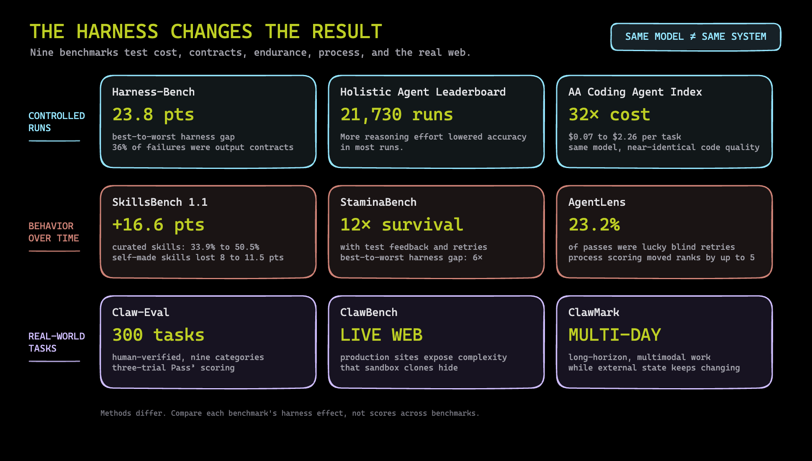

<!--
These benchmarks test different tasks and should not be compared by raw score. Read each card as evidence that the harness changes cost, reliability, process quality, or endurance.

Harness-Bench: 106 oracle-checkable tasks across six harnesses and eight models. The best-to-worst harness gap was 23.8 points, and output-contract violations caused 36% of failures.
HAL: 21,730 rollouts across nine models and nine benchmarks. More reasoning effort reduced accuracy in most runs, and log review found agents searching for benchmark answers.
AA Coding Agent Index: Claude Opus 4.7 cost ranged from $0.07 to $2.26 per task across Claude Code, Cursor CLI, and OpenCode with near-identical code quality.
SkillsBench 1.1: Curated skills raised resolution from 33.9% to 50.5%. Self-generated skills reduced it by 8 to 11.5 points.
StaminaBench: Test feedback and retries improved survival by up to 12 times. The strongest models still showed a six-times harness gap.
AgentLens: Process-level rescoring found that up to 23.2% of passes were lucky blind retries. Rankings moved by up to five places.
Claw-Eval uses 300 human-verified tasks and three-trial scoring. ClawBench runs against live production websites. ClawMark tests multi-day, multimodal work while external state changes.
-->

---
layout: center
class: 'text-center'
---

  Rank 30 → top 5

  on <a href="https://www.tbench.ai/">Terminal-Bench 2.0</a> for DeepAgents

  with <strong class="text-[#95E6FF]">harness-only changes</strong>, same model

<a class="text-[11px]" hreaf="https://www.vtrivedy.com/posts/improving-deep-agents-with-harness-engineering">Source: Trivedi, “Improving Deep Agents with Harness Engineering” (LangChain, 2026)</a>

<!--
building a good harness arround the models make a real sense
Usually native runtime harnesses are the best

But there are exceptions
-->

---
layout: center
class: 'text-center'
---

  The LLM is ~10% of an agentic system

  the harness is the other <strong class="text-[#95E6FF]">90%</strong>

 

  Google's <em>The New SDLC With Vibe Coding</em> — conceptual framing

<!--
Google's 2026 paper

The New SDLC With Vibe Coding 

From Ad-hoc Prompting to Agentic Engineering uses the framing:
Agent = Model + Harness

Here the harness doesn't mean claude only
It has parts of it but not all...

SWARM
Validation 
-->

---
layout: center
class: 'text-center'
---

  What model does it use? Or do you use?

 

  is increasingly the <a href="https://magnus919.com/2026/06/stop-picking-models.-start-building-harnesses./" class="bold text-[#CF8377]">wrong question</a>

---
layout: center
class: 'text-center'
---

  at Stripe

  ~1,300 AI-produced PRs / week

  Merged after <strong class="text-[#95E6FF]">human review</strong>

<a class="text-sm" hreaf="https://stripe.dev/blog/minions-stripes-one-shot-end-to-end-coding-agents-part-2">Source: Stripe</a>

<!--
we know that we can't ignore AI 

The speed of AI is increasing pretty fastttt

We said the same thing in HEMA and decided to move faster
-->

---
layout: center
class: 'text-center'
---

  The future is agentic  
  so at HEMA we're building 
  a full harness, just like Claude

  Our own complete agent runtime 

---
layout: center
class: 'text-center'
---

  Lied!

  No custom runtime, we using different <strong>AI Agents</strong> 
  What we <strong class="text-[#BECF24]">Do</strong> have is an <strong class="text-[#BECF24]">Organization Harness</strong> around an agentic CLI

  

---

# Two kinds of harness 

 Runtime harness

    Everything that makes an LLM capable of operating as a <strong class="text-[#95E6FF]">coding agent</strong>.

    Filesystem · shell · tools · context management · skills · sub-agents · permissions · hooks · MCP · compaction

    Shipped (in different forms) by Claude Code, Codex, opencode…

 Engineering harness

    Everything that makes agents <strong class="text-[#BECF24]">reliable and scalable</strong> in an organization's development process.

    Specs · orchestration · workers · validators · evals · guardrails · CI · observability · feedback loops

    The part <em>you</em> build — often where your real edge lives 

 

> Agent = model + runtime harness. <strong>Production agent</strong> = all of it, wrapped in an engineering harness.

    The runtime gives the building blocks (hooks, permissions, sub-agents). The engineering harness uses them at team scale.

---

# What did we want it?

   <strong>Specs / intent layer</strong> — specs as the primary artifact

   <strong>Orchestrator</strong> — spec in, tasks out

   <strong>Workers</strong> — sub-agents, in parallel

   <strong>Validators</strong> — evaluate, never modify

   <strong>ACL</strong> — output, trajectory, tool usage

   <strong>Guardrails / hooks</strong> — around every tool call

   <strong>Observability</strong> — cost, eval scores, drift

   <strong>Feedback loop</strong> — failures flow back to workers

  End to End - Secure - Up to date - Reliable

---

# Meet opa-cli 

  One CLI that controls everything — the whole pipeline, end to end:

  📝 Spec creation
  →
  🎫 Jira ticket
  →
  📄 Create PRD
  →
  🛠️ Implement
  →
  📏 Guidelines

↓

  🔑 AWS profiles
  →
  ⚙️ AWS Pipelines
  →
  🚀 Deploy
  →
  🧪 Test

  Every step of the organization harness — driven by one command.

<!--
It doesn't mean we can one-shot tickets
But we do have a pretty high quality results...
-->

---
layout: center
class: 'text-center'
---

  High-quality input = high-quality output

  + the right <strong class="text-[#95E6FF]">tools</strong> and good <strong class="text-[#95E6FF]">context</strong>, for sure

-  <strong>Inputs</strong> — meeting transcripts, docs, tickets, prior decisions, MCPs built in collaboration to AWS

---
layout: center
class: 'text-center'
---

# Harnesses matter. Then they disappear.

  We debate the layer doing the work today. 
  Mature abstractions turn that layer into an implementation detail.

The argument is not that harnesses do nothing. It is that their differences should shrink.

<!--
The transcript opens with an apparent contradiction: harnesses matter right now, yet the goal is for users to stop thinking about them. Good infrastructure becomes invisible when it works.
-->

---

  

What deserves your attention?

Product

Engineers

Architecture

Languages

Frameworks

Algorithms

Tabs vs spaces

more outcome

<!--
Developers care about many layers. Tabs and spaces sit near the bottom. Product outcomes sit at the top. Our attention should follow the impact, not our attachment to a tool.
-->

---

  

Abstraction moves the line

the work moves up a layer

assembly

CPU instructions

C

portable programs

formatters

style becomes a setting

autocomplete

functions become a suggestion

agents

implementation becomes delegated

<!--
Assembly gave way to portable languages. Formatters absorbed style choices. Autocomplete absorbed routine functions. Agents now absorb larger implementation tasks. Each step moves the line of required attention upward.
-->

---

  

An LLM only produces text

Prompt

text in

LLM

Response

text out

no files changed

no commands run

<!--
Strip away the product framing and an LLM has one primitive: it consumes text and emits text. A response alone does not read a repository, edit a file, or run a command.
-->

---

  

The empty kitchen

Smart chef

knows the recipe

Empty

no knife no pan no stove

No dinner

Capability without tools cannot become action.

<!--
Use the kitchen analogy from the transcript. A brilliant chef in an empty room can describe dinner but cannot cook it. Capability needs tools and an environment where actions have consequences.
-->

---

  

A harness turns syntax into action

User intent

Harness

protocol + loop

LLM

Tools

files, shell, APIs

read → decide → act → observe → repeat

<!--
A harness gives the model a tool-call syntax, interprets that syntax, executes the requested action, returns the result, and continues the loop. That conversion from text to action is the core job.
-->

---

  

Interface or harness?

Human

Interface

what you see and control

CLI / app / web UI

Harness

what the model uses to act

tool schema / loop / context

Tools

<!--
An interface is what the human sees and controls. A harness is what the model uses to act. One product can contain both, but the roles are still different.
-->

---

  

Claude Code has two layers

Claude Code CLI / app interface

human interaction

model action

Agent SDK + binary harness

<!--
The transcript uses Claude Code to show why the terms get mixed up. The interactive CLI or app is the interface. The Agent SDK and binary provide the loop, context management, and tools of the harness.
-->

---

  

LLM + harness = agent

LLM

reason + text

+

Harness

tools + loop

=

Agent

completes tasks

The model supplies decisions. The harness supplies consequences.

<!--
This is the compact definition: a model combined with a harness becomes an agent. The model supplies reasoning and text. The harness supplies tools, context, a system prompt, and the execution loop.
-->

---

  

Two planes around the model

Tool plane

files shell editor sub-agents

LLM

Data plane

MCP databases analytics other systems

code runs inside the harness

bindings reach outside it

<!--
The transcript separates two kinds of capability. The tool plane contains actions built into or loaded by the harness. The data plane connects the agent to systems outside the harness.
-->

---

  

T3 Code coordinates harnesses

Human

T3 Code

ADE + MCP coordination

Claude Code

Codex

Other harness

one interface, native harness behavior

<!--
T3 Code does not replace every harness. Its interface and MCP layer coordinate them. Claude Code keeps its own skills and plugins. Codex keeps its own behavior. T3 Code brokers work and history across them.
-->

---

  

The model picker is a harness picker

Claude

Claude Code

skills + plugins

Codex

Codex

native setup

Other

Its harness

its tools

Choose the capability and price you need. Keep the native kitchen.

<!--
Changing the selected model often changes the native harness too. Think of the picker as choosing both a chef and a kitchen. Select the capability and price you need without pretending every kitchen has the same tools.
-->

---

  

From IDE to ADE

Agentic development environment

Interfaces

Harnesses

Models + tools

attention moves up

<!--
The transcript names T3 Code an Agentic Development Environment, or ADE. It sits above interfaces and harnesses as the place where humans manage agentic work. Like IDEs, ADEs may become less visible as the next abstraction arrives.
-->

---
layout: center
class: 'text-center'
---

  
  

    
Now meet the control surface

    <h1 class="text-6xl!">T3 Code</h1>
    
One place to run, watch, and coordinate coding agents.

    
Open source. Your machines. Your provider subscriptions.

  

<!--
01.md describes T3 Code as an open-source app for working with coding agents. The current official README calls it an agent harness control surface. This section turns that summary into a product tour.
Source: https://github.com/pingdotgg/t3code
-->

---

# T3 Code is not a harness

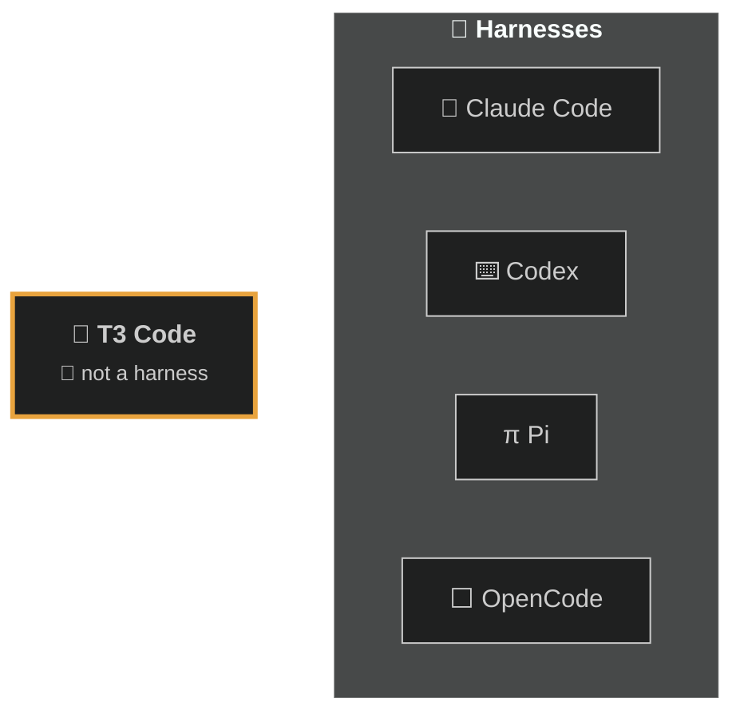

---

  

Live capture from <a href="https://t3.codes">t3.codes</a>, 5 Nov 2026

<!--
The current public positioning is direct: T3 Code is the open-source control plane for coding agents. It coordinates several agent products from one surface.
-->

---

  

Official product screenshot from <a href="https://t3.codes">t3.codes</a>

<!--
Orient the audience. The left side is the thread inbox, the center is the active conversation, and the right side holds the project, Git, and sub-agent context.
-->

---

  

One surface, many agents

Claude

Codex

T3 Code

control surface

Cursor

Grok

OpenCode

keep each harness native

<!--
The value is not a new model. T3 Code gives Claude Code, Codex, Cursor, Grok Build, OpenCode, Antigravity, and other supported providers a shared control surface while retaining their native behavior.
Source: https://github.com/pingdotgg/t3code#readme
-->

---
layout: center
class: 'text-center'
---

# Bring your own everything

  

    
SUBSCRIPTIONS

    
Use the plans you already have

    
Claude, ChatGPT, Cursor, Grok, OpenCode, and others stay yours.

  

  

    
COMPUTE

    
Agents run on your machines

    
A laptop, workstation, or remote VM does the work.

  

  

    
CONTROL

    
T3 Code coordinates both

    
The app does not resell model access or cloud compute.

  

Free and MIT licensed. The cost comes from your providers and machines.

<!--
This is one of the clearest points in 01.md. T3 Code is free, but it does not include inference or compute. Users connect subscriptions and machines they control.
-->

---

# One thread can become a team

  

  One parent thread
  Claude + Codex + Muse + Gemini sub-agents
  One lineage panel

<!--
The official screenshot shows four sub-agents in one thread. 01.md also describes threads communicating with one another. The user starts with one task and delegates work to different models where useful.
-->

---

# Threads connect through MCP

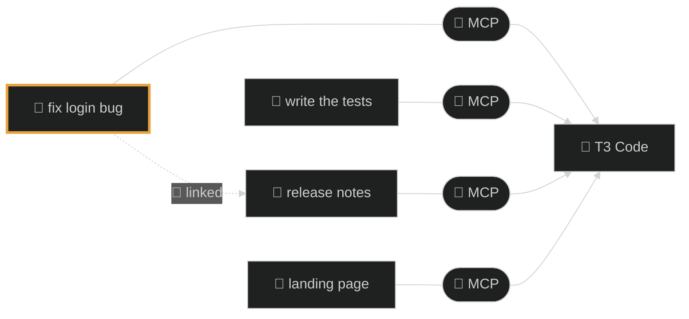

---

# The sidebar is an inbox for work

  

    
  

  

    

      
Working

      
Hide active work without losing it.

    

    

      
Snoozed

      
Return when the timing is better.

    

    

      
Settled

      
Close completed work and clear attention.

    

  

<!--
01.md treats thread management as an inbox. The point is operational: close work when it is done, snooze it when it is not urgent, and keep running work out of the way.
-->

---

  

Threads are an inbox

Draft

start

Working

agent runs

Snoozed

later

Settled

done

Archived

out of sight

Merged pull requests can settle their thread automatically.

<!--
A thread has a lifecycle. Draft, working, snoozed, settled, archived. Linked pull requests can move work toward completion, and merged work can settle automatically.
-->

---
layout: center
class: 'text-center'
---

# Sending does not mean waiting

  

    
Send in background

    
Start the turn and keep navigating.

  

  
→

  

    
Start more work

    
Run several independent threads at once.

  

The unit of attention changes from "watch this agent" to "manage this queue."

<!--
01.md calls out Command plus Enter for background send. The exact shortcut can be configured, but the workflow matters more: sending a prompt should not lock the user into watching it finish.
Source: https://github.com/pingdotgg/t3code/blob/main/docs/user/keybindings.md
-->

---

  

Control your machines from anywhere

Desktop

Web

Phone

T3 Connect

or private route

Laptop

Workstation

Remote VM

the agents and compute stay on your machines

<!--
T3 Code can connect desktop, web, and mobile clients to several machines. Current docs support T3 Connect, LAN or private-network pairing, Tailscale HTTPS, and desktop-managed SSH.
Source: https://github.com/pingdotgg/t3code/blob/main/docs/user/remote-access.md
-->

---

# Three machines, one client

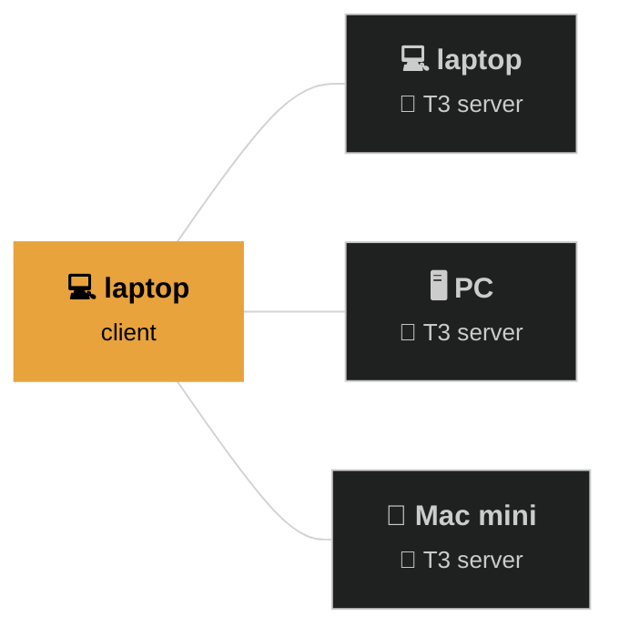

---

# At home, the LAN is enough

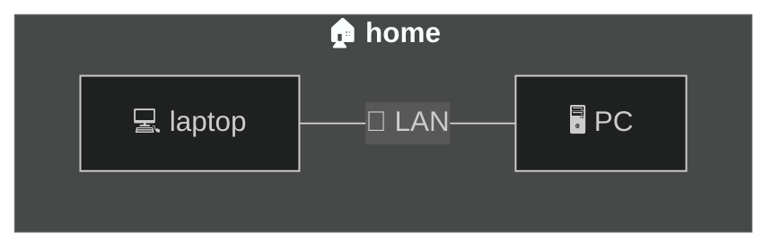

---

# T3 Connect

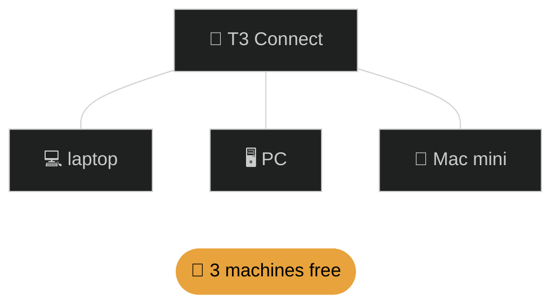

---

# T3 Connect vs Tailscale

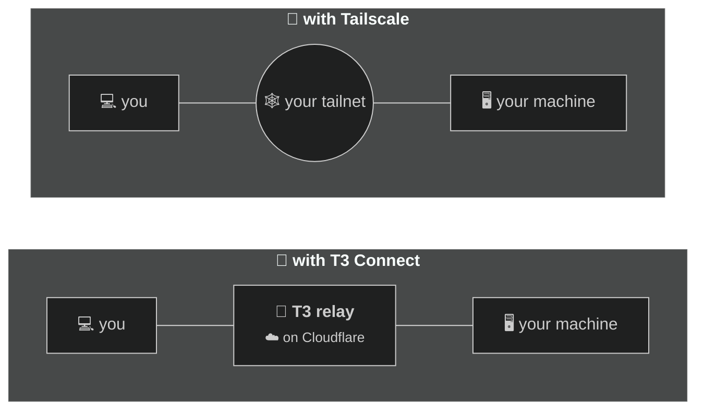

---

  

Send work where capacity exists

New thread

Choose host

MacBook

1 slot free

Mac Studio

8 slots free

Linux VM

3 slots free

pick once, then keep the thread on that machine

<!--
When a draft needs a machine, T3 Code can examine eligible hosts and choose one with free capacity. After selection, the thread stays on that environment.
Source: https://github.com/pingdotgg/t3code/blob/main/docs/user/remote-access.md#balance-new-threads-across-machines
-->

---

# Development life cycle

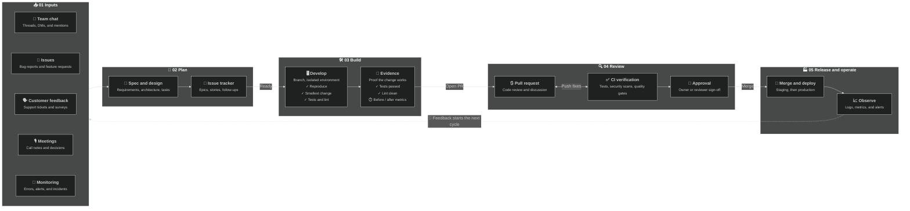

---

  

From thread to merged pull request

Thread

Commit + push

Pull request

Checks + review

Merge + settle

linked reviews stay with the work that created them

readiness, stacks, diffs, merge, done

<!--
A thread can commit, push, create a pull request, review changes, and merge. Linked pull requests remain attached to the work that produced them, including stacked reviews.
Source: https://github.com/pingdotgg/t3code/blob/main/docs/user/source-control.md
-->

---
layout: center
class: 'text-center'
---

# Source control is built into the work

  
GitHub

  
GitLab

  
Bitbucket

  
Azure DevOps

  
Forgejo

  
Gitea

  
GitCafe

  
Your Git host

Review diffs, link pull requests, inspect stacks, and merge without leaving the thread.

Source: <a href="https://github.com/pingdotgg/t3code/blob/main/docs/user/source-control.md">official source-control docs</a>

<!--
The current documentation lists GitHub, GitLab, Forgejo, Gitea, Bitbucket, Azure DevOps, and GitCafe. This is wider than the PR-only framing in 01.md.
-->

---

  

Work can start without a human click

Schedule

cron or interval

Webhook

event payload

Automation policy

New agent thread

signed requests, dedupe keys, held delivery

<!--
Schedules and webhooks can start threads. Current webhook settings support signed requests, payload placeholders, deduplication keys, and delivery held by T3 Connect for up to 24 hours while an environment is unavailable.
Source: https://github.com/pingdotgg/t3code/blob/main/docs/user/project-settings.md#webhook-automations
-->

---
layout: center
class: 'text-center'
---

# See where the tokens go

  

    
BY ACCOUNT

    
Who?

    
Compare usage across connected provider accounts.

  

  

    
BY MACHINE

    
Where?

    
See which environment is consuming the work.

  

Parallelism increases throughput. It can also increase spend.

<!--
01.md names a usage tab with views by account and machine. This turns hidden token consumption into an operational signal.
-->

---
layout: center
class: 'text-center'
---

# The control surface fits in your pocket

  
  

    
iOS and Android clients

    

      
Control threads on remote machines

      
Choose a host before sending work

      
Inspect connected simulator and emulator sessions

      
Manage scheduled tasks from mobile

    

  

Sources: <a href="https://github.com/pingdotgg/t3code/tree/main/apps/mobile">mobile app</a> · <a href="https://github.com/pingdotgg/t3code/blob/main/docs/user/remote-access.md">remote access docs</a>

<!--
The mobile client is not a smaller editor. It is a remote operations interface for agent work and connected machines.
-->

---

# Fleet skill: one HQ on every machine

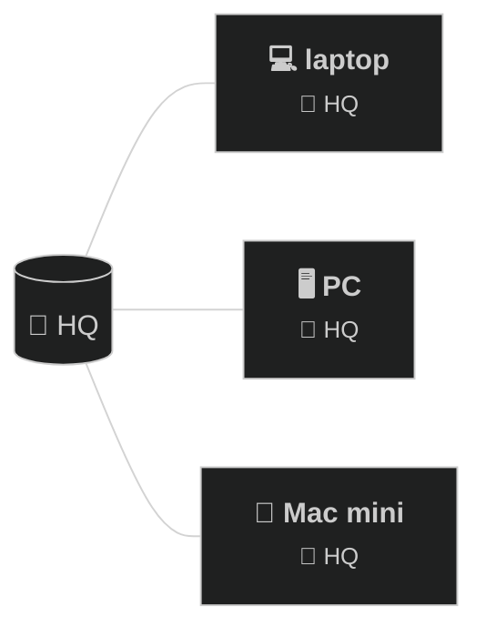

---

# Skills live in HQ

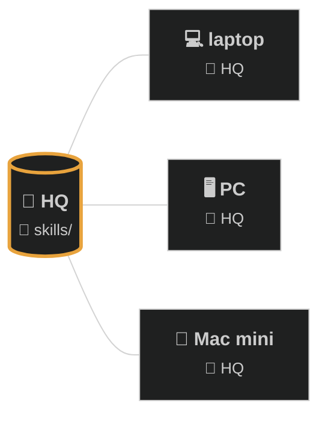

---

# Linked servers

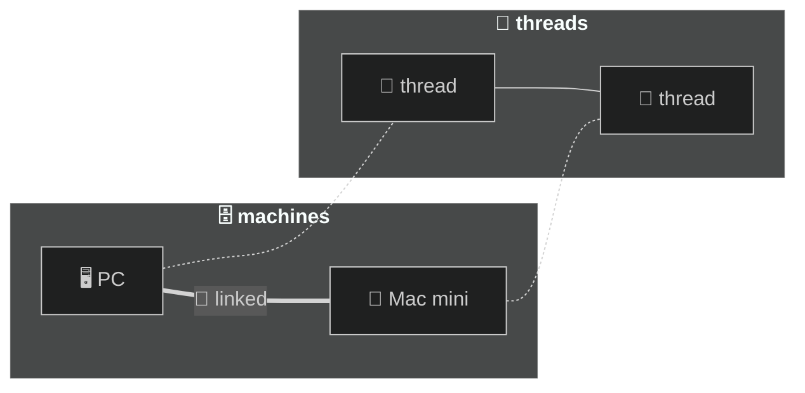

---

# Subagents on other machines

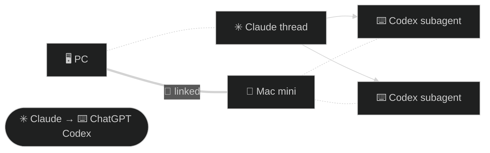

---

# Two kinds of links

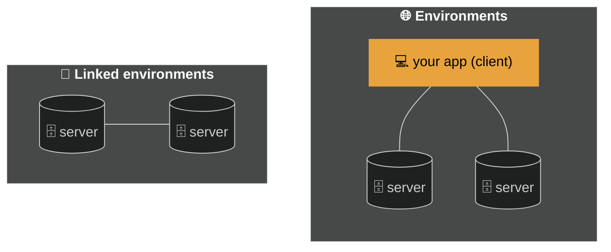

---

# Small tools remove workflow friction

  

Drafts

Keep prompts before sending.

  

Stashes

Protect local changes.

  

Attachments

Give agents files to inspect.

  

HTML render

Show generated visuals in chat.

  

Snapshots

Capture the current state.

  

Themes

Tune the interface.

  

Editor handoff

Open remote work in VS Code.

  

Transfers

Move projects between machines.

The product is a collection of small operational shortcuts around long-running agent work.

<!--
These are the smaller features listed in 01.md. They matter because agent work spans files, machines, threads, and long periods of time.
-->

---

  

Triage with the agent you already pay for

T3 Code problem

Collect

logs, state, version, known issues

Claude or Codex

Diagnosis + next step

The agent asks before applying a fix or posting an issue.

<!--
If the app fails, npx t3 triage collects logs, state, version information, and known issues. It starts Claude Code or Codex with the same playbook used by in-app triage. The agent asks before applying a fix or posting anything.
Source: https://github.com/pingdotgg/t3code/blob/main/docs/user/triage.md
-->

---
layout: center
class: 'text-center'
---

# What T3 Code does not hide

  

    
You bring subscriptions

    
Provider limits and token costs still apply.

  

  

    
You bring compute

    
Your machines run the agents and tools.

  

  

    
Nightly changes quickly

    
Fast releases can introduce short-lived breakage.

  

  

    
More throughput uses more tokens

    
Parallel work needs explicit budget awareness.

  

It is built for developers managing coding agents, not as a general-purpose consumer assistant.

<!--
01.md is useful because it includes limits. The control plane removes coordination friction, but it cannot remove provider limits, compute costs, or the operational cost of running many agents.
-->

---
layout: center
class: 'text-center'
---

# A game changer

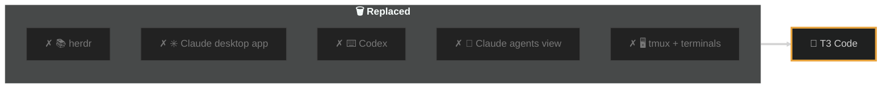

---

  
  

    
OPEN SOURCE CONTROL PLANE

    <h1 class="text-5xl! mt-3">Try it. Inspect it. Fork it.</h1>
  

  

47,521

GitHub stars

  

MIT

license

  

BYO

models + compute

  <a href="https://t3.codes" class="text-[#95E6FF]">t3.codes</a>
  ·
  <a href="https://github.com/pingdotgg/t3code" class="text-[#BECF24]">github.com/pingdotgg/t3code</a>

Repository figures retrieved 5 Nov 2026 from the GitHub API. Content adapted from 01.md and current official docs.

<!--
Close the product introduction with a practical invitation. The current repository is MIT licensed and had 47,521 stars when this section was prepared. Avoid presenting the count as permanent.
-->

---

# Resources 

## Used in this deck

- **Harness transcript:** [My last video about AI harnesses](https://www.youtube.com/watch?v=ebILGCoN4UU)
- **T3 Code summary:** [T3 Code broke me](https://youtu.be/uLGxb4F3SyI)
- **T3 Code:** [t3.codes](https://t3.codes)
- **Source and releases:** [pingdotgg/t3code](https://github.com/pingdotgg/t3code)
- **Remote access:** [official docs](https://github.com/pingdotgg/t3code/blob/main/docs/user/remote-access.md)
- **Source control:** [official docs](https://github.com/pingdotgg/t3code/blob/main/docs/user/source-control.md)
- **Automations:** [project settings](https://github.com/pingdotgg/t3code/blob/main/docs/user/project-settings.md)
- **Troubleshooting:** [triage docs](https://github.com/pingdotgg/t3code/blob/main/docs/user/triage.md)

## Harness engineering

- **HEMA HAL:** [AWS case study](https://aws.amazon.com/blogs/machine-learning/from-portal-hopping-to-instant-answers-hemas-journey-with-mcp-and-amazon-bedrock/)
- **OpenAI DevDay 2026:** [recap](https://openai.com/index/devday-2026-recap)
- **Anthropic coding trends:** [2026 report](https://resources.anthropic.com/2026-agentic-coding-trends-report)
- **AI coding agents:** [JetBrains research](https://blog.jetbrains.com/research/2026/08/ai-coding-agent-adoption-2026)
- **autoharness:** [self-learning harness](https://github.com/tigerless-labs/autoharness)
- **myagents:** [portable harness](https://github.com/RashadAnsari/myagents)
- **Collection:** [Awesome harness engineering](https://github.com/ai-boost/awesome-harness-engineering)

## Foundations

- **AI transformation:** [Just Another Transformation](https://dpereira.substack.com/p/just-another-transformation)
- **Harness engineering:** [Martin Fowler](https://martinfowler.com)
- **DeepSeek Harness:** [source](https://github.com/deepseek-ai/deepseek-harness)
- **DeepSeek overview:** [MindStudio](https://mindstudio.ai/blog/deepseek-harness-agentic-coding)
- **Harness deep dive:** [video](https://youtu.be/UsfCe5fJK6A)
- **Skylos:** [catch mistakes before push](https://github.com/duriantaco/skylos)

T3 Code screenshots came from the official site and repository on 5 Nov 2026.

---
layout: center
class: 'text-center'
---

# Thank you! 

 

<a href="github.com/sayjeyhi" >
 github.com/sayjeyhi
</a>
<a href="https://sayjeyhi.com">
 sayjeyhi.com
</a>

  

  <a class="text-left ml-4 mt-2" href="https://github.com/sayjeyhi">
    <strong class="text-xl">Jafar Rezaei</strong>  
    @sayjeyhi
  </a>

<!--

Spec-driven development. GitHub Spec Kit gives you a CLI that turns specs into plans into tasks. OpenSpec adds a three-phase state machine for brownfield changes. BMAD-METHOD ships 21 role-based agents across the full SDLC. Superpowers provides a skills framework with subagent test-driven development. These tools treat specs as the primary artifact. None of them connect a spec to an automated eval suite that verifies the agent actually satisfied what the spec asked for.

Multi-agent orchestration. CrewAI gives you role-based crews with a hierarchical manager that delegates and reviews: the closest thing to orchestrator/worker separation in open source. AutoGen and LangGraph provide graph-based and conversation-driven multi-agent patterns. But here is what none of them enforce: the validator must never touch the implementation. That separation is still a discipline you impose, not a constraint the framework guarantees.

Evaluation. DeepEval and Promptfoo give you frameworks for testing LLM output quality, red-teaming, and vulnerability scanning. LangSmith and Braintrust provide hosted eval platforms with LLM-as-judge capabilities. The missing piece: accepting a structured spec and auto-generating a scenario suite that computes per-requirement satisfaction scores. The spec-to-eval bridge (the thing that tells you whether the agent actually built what you asked for) is unbuilt in open source.

Guardrails. NVIDIA NeMo Guardrails and Guardrails AI provide programmable safety rails for conversational AI. These are not coding harness guardrails. There is no open source framework for pre-commit hooks that block hardcoded credentials, no API call allowlist enforced at the tool level, no eval gate that rejects a pull request below a quality threshold. The guardrail layer for agentic coding is empty.

Observability. Langfuse gives you self-hosted tracing with token cost tracking and latency visibility. Arize Phoenix provides drift detection and RAG evaluation. Here is what neither tracks: spec compliance over time. The measurement that tells you when a spec that used to produce good output has started producing bad output, and why.

-->